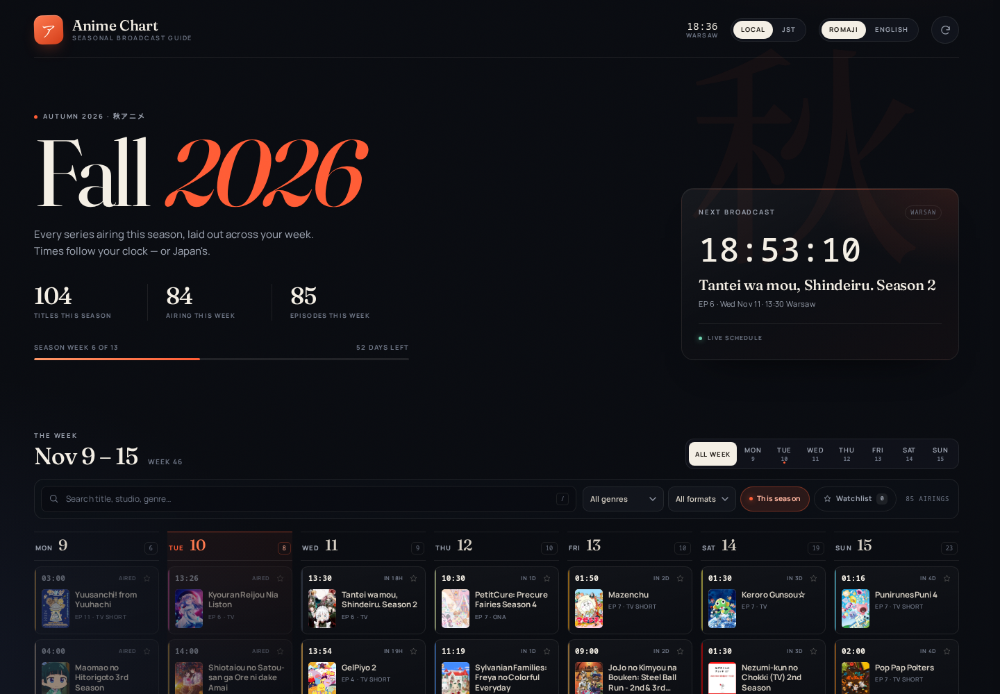

# Anime Chart

A weekly broadcast guide for the current anime season — built around **Fall 2026** and powered live by [AniList](https://anilist.co).



## What it does

- **This week's schedule** — every seasonal series mapped across Monday–Sunday, with exact local air times and episode numbers.
- **Live data** — queries the AniList GraphQL API for the current season and this week's airings on load. Season detection is automatic, so the same app rolls into Winter 2027, Spring 2027, etc.
- **Romaji / English titles** — switch every title in the interface from Japanese romaji to English (falling back to romaji when no English title exists). Search always matches **all** title variants at once.
- **Local time or JST** — flip all times between your time zone and Japan Standard Time.
- **Next broadcast countdown** — a live countdown to the nearest episode, including next week's premieres when the current week is done.
- **Search and filters** — search by title, studio or genre; filter by day, genre and format.
- **Continuing series** — “This season” is on by default; switch it off to include shows from earlier seasons that are still airing.
- **Watchlist** — star any title; saved to `localStorage` and filterable.
- **Details** — poster, banner, synopsis, studio, score, season progress, broadcast slot and full episode schedule.
- **Offline snapshot** — a bundled Fall 2026 snapshot (November 10, 2026) renders instantly if the API is unreachable. The app also caches live data for the current week.
- **Responsive** — a seven-column TV guide on desktop, a day view with two-column cards on phones.

## Running it

The application is split into ES modules, so serve the folder over HTTP:

```bash
cd "anime chart"
python3 -m http.server 8000
# then open http://localhost:8000
```

You can also open `index.html` directly. When it detects `file://`, it loads the prebuilt classic bundle in `js/dist/app.bundle.js` instead of the modules, so the app keeps working without a server. If your browser blocks API requests from `file://`, the bundled snapshot still renders and the app tells you so.

There are no runtime dependencies.

## Using it

| Action | How |
| --- | --- |
| Switch time zone | **Local** / **JST** in the header |
| Switch titles | **Romaji** / **English** in the header |
| Show one day | Day tabs above the board, or **All week** |
| Search | Type in the search bar, or press `/` — both title languages match |
| Clear search | `Esc` while the search field is focused |
| See a full day | Click **See all N** at the bottom of a capped day column |
| Watchlist | Click the star on a card or in the details dialog |
| Refresh | The circular arrow in the top-right |
| Close details | `Esc`, the close button, or click the backdrop |

On mobile the app opens on today's schedule; on desktop it opens on the full week.

## Project structure

```
anime chart/
├── index.html                  # shell, header controls, detail dialog
├── css/style.css               # design system, layout, responsive rules
├── js/
│   ├── main.js                 # ES-module entry point
│   ├── modules/
│   │   ├── api.js              # AniList queries, normalization, cache
│   │   ├── config.js           # constants, labels, time zones
│   │   ├── controller.js       # data loading, events, boot, filters
│   │   ├── datetime.js         # time-zone/date math and formatting
│   │   ├── detail.js           # detail dialog
│   │   ├── labels.js           # format/status/date labels
│   │   ├── render.js           # header, board, extras, countdown, footer
│   │   ├── schedule.js         # derived schedule, search, filters
│   │   ├── state.js            # shared state and DOM references
│   │   ├── titles.js           # romaji/English title selection
│   │   └── utils.js            # escaping, storage, colors, helpers
│   └── dist/
│       └── app.bundle.js       # generated IIFE bundle for file:// use
├── data/fallback.js            # bundled Fall 2026 snapshot
├── preview.png                 # screenshot of the Fall 2026 board
└── README.md
```

The fonts (Fraunces and Manrope) are inlined into the stylesheet so the app keeps its typography when opened from `file://`. Both are licensed under the SIL Open Font License.

## Rebuilding the file bundle

`js/modules/` is the source of truth. The bundle exists only so modules work when the page is opened from `file://`. After changing any module, regenerate it with:

```bash
npx --yes esbuild js/main.js --bundle --format=iife --target=es2019 --outfile=js/dist/app.bundle.js
```

This requires Node/npm but is **not** needed just to run the app. The server version always uses the modules directly.

## Data notes

- Schedule data comes from the [AniList GraphQL API](https://docs.anilist.co/). This project is not affiliated with AniList or any studio.
- Times are broadcast times reported by AniList, converted from UTC to the selected time zone. Daylight-saving changes are handled by `Intl`.
- A “week” runs Monday 00:00 through Sunday 23:59 in the selected time zone.
- Air times can change; the app refreshes from AniList on load, on **Refresh**, and after 15 minutes in a background tab when you return.
- The bundled snapshot is intentionally only a fallback. Delete `data/fallback.js` (or leave it) and the app will still work online.

## Tweaking

- **Season** is derived from the current date in `seasonOf()` in `js/modules/datetime.js` (`WINTER` Jan–Mar, `SPRING` Apr–Jun, `SUMMER` Jul–Sep, `FALL` Oct–Dec).
- **Column cap** in the all-week view is the `12` passed to `dayColumn()` in `js/modules/render.js`.
- **Title language default** lives in `state.js`; the header buttons are wired in `controller.js`.
- **Accent color** and typography live in the `:root` block at the top of `css/style.css`.
